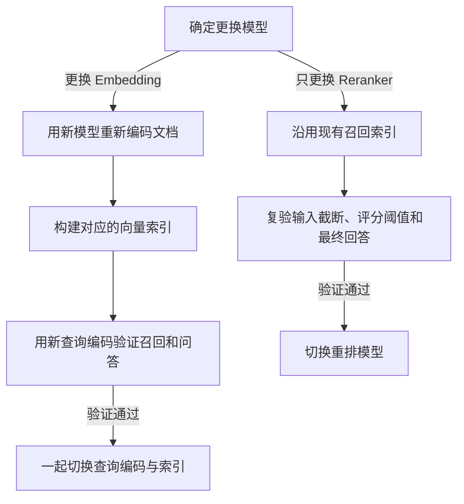

知识库找不到正确资料时，换一个 Embedding 模型可能有帮助；正确资料已经进入候选池但排得靠后时，更值得检查重排。原文缺失、权限过滤错误或切分丢掉条件时，换模型也无法补回这些信息。

排障方法已经在 [RAG 检索优化](./rag-optimization.md)中展开。本文讨论确认模型值得比较以后，如何筛选候选、安排对照，以及根据哪些证据决定更换。

## Embedding 与 Reranker 需要一起更换吗？

**不需要。先分别判断两者解决的问题，再测试组合效果。** 常见双塔检索分别编码问题与文档，适合从大量文档中取得候选；Cross-Encoder 类重排模型联合处理问题和候选内容，进一步比较相关性。具体流程可参考 [Sentence Transformers 的 Retrieve & Re-Rank 文档](https://www.sbert.net/examples/sentence_transformer/applications/retrieve_rerank/README.html)。

假设用户问“线程池在什么条件下触发拒绝策略”。如果候选里只有参数解释，没有触发条件的原文，应检查召回；如果正确片段已经存在，只是被不相关示例挤到最终截断范围之外，才有理由优先比较 Reranker。

Reranker 不会增加候选池之外的文档。单独比较重排模型时，要固定同一批候选片段；否则换了 Embedding 后候选变好，容易被误认为是重排模型的提升。

## 比较效果前，先筛掉哪些候选？

候选模型首先要满足业务约束，再进入效果比较。官方模型卡和 API 文档用于确认能力与输入要求，公开排行榜只能提供候选线索。

| 约束           | 核对什么                                                   | 为什么影响选择                             |
| -------------- | ---------------------------------------------------------- | ------------------------------------------ |
| 语言与资料类型 | 中文、英文混合，缩写、错误码、表格文本是否在业务样本中出现 | 通用分数不能说明它能区分业务术语和相近条件 |
| 输入要求       | 最大输入、截断方式、Query/Document 指令或前缀              | 同样的原文可能实际只被模型读取了一部分     |
| 向量配置       | 维度、归一化、相似度计算及版本                             | 查询与文档编码必须兼容，不能只改查询侧模型 |
| 部署与授权     | 数据能否外发、许可、运行资源、服务限流                     | 效果合适也可能无法在目标环境使用           |
| 重排开销       | 候选数量、文本长度、并发下延迟和失败率                     | 离线单条请求表现不等于线上负载表现         |

模型确定之后，要先核对实际送入的文本。例如代码原来会给问题拼接 Query 指令，换模型时就得检查这段拼接是否仍然需要。[BGE-M3 官方模型卡](https://huggingface.co/BAAI/bge-m3)明确说明，检索时不要求给 Query 添加指令；其他模型应分别按自己的用法处理。BGE-M3 还支持稠密、稀疏和多向量检索，记录结果时也要说明使用了哪一种。

对于托管服务，还要把返回结果对应回原文。[Cohere Rerank](https://docs.cohere.com/docs/rerank-overview)接收问题和文档列表，返回的 `index` 用于定位输入文档，`relevance_score` 表示相关性评分。接入时若弄错索引，即使模型排序正确，最后拿到的也会是另一段文字。模型标识、版本、配置和资料核对日期应随评测结果保存，方便后续复现。

## 如何单独比较 Embedding？

**固定问题和文档，再分别生成向量、执行检索。** 先准备同一份语料及切分结果，确定权限过滤条件和候选数量。比较时每个模型都读取这套材料。新模型如果多返回了候选，正确片段更容易出现，这种差异就不能直接算成模型的提升。

模型 A 生成一套文档向量，模型 B 生成另一套；查询时也分别用 A、B 编码同一个问题。两套向量即使维度相同，也未必处于可兼容的向量空间。查询向量和文档向量混用后，距离就不再能可靠表达我们要比较的相关性。前缀、归一化和距离函数则按照对应模型的要求设置。

如果正确片段没有返回，还需要区分模型与索引的问题。精确检索会按所选距离计算候选，近似索引则可能漏掉本应排在前面的向量。可以先在规模可控的语料上做精确检索，再检查目标索引的结果和实际负载表现。这个过程中保留原来的 Chunk；同时修改切分、索引参数和模型，会失去判断差异来源的对照。

问题集也应覆盖不同的查询方式：“线程池拒绝任务”使用自然语言，“RejectedExecutionException”使用异常类名，“队列没满为什么也拒绝了”则给出了一个需要解释的条件。最后一题需要考虑线程池已经关闭的情况，召回内容若只有队列容量和线程数，就还缺少证据。因此，标注时需要指出能回答问题的具体片段，不能把整篇《线程池详解》都算作正确证据。

比较结果时，除了看整体召回情况，还要单独检查错误码、缩写、条件冲突等类别。整体结果变好，也可能掩盖某一类问题的退步。指标计算和评测数据的隔离方法见 [RAG 评测](./rag-evaluation.md)。

## 如何单独比较 Reranker？

**把同一份粗召回结果交给不同 Reranker，看它们怎样重新排序。** 问题、候选片段及候选的初始顺序保持一致，同时保留不重排的结果作为基线。只有和原始召回顺序比较，才能知道多调用一次重排模型是否有帮助。

还是以线程池问题为例。包含“线程池关闭后拒绝新任务”的片段已经在候选池里，但排在较后的位置。重排后，要检查它能否进入最终保留的片段，而不只是分数有没有升高。比较排序时，最终保留的片段数也应一致。

输入截断会影响这次比较。如果两个模型的长度限制不同，一个读到了完整正文，另一个没读到末尾的关闭条件，排名差异就包含了截断的影响。评测记录需要留下实际输入和截断方式，排查时才能区分这些原因。

排序之后还有上下文拼接。一个片段即使排在前面，也可能因为太长而被裁掉后半段。因此，还要在相同的上下文预算下跑完整问答，检查模型是否引用了正确证据、证据不足时是否拒答；涉及工具的回答，也要检查是否遵守工具的调用条件。

## 逐题记录应该怎么看？

逐题记录可以把“有没有召回”和“排在什么位置”分开看。假设配置 A、B 在四类问题上的检索结果如下：

| 问题类型     | 已标注的正确证据                 | 配置 A       | 配置 B       | 应继续检查什么                                     |
| ------------ | -------------------------------- | ------------ | ------------ | -------------------------------------------------- |
| 错误码查询   | 明确解释错误码的片段             | 未进入候选池 | 进入候选池   | 是模型改善，还是关键词召回配置也变了？             |
| 相近条件区分 | 区分“队列满”与“线程池关闭”的片段 | 重排后第 6   | 重排后第 2   | 相同候选下是否改善，最终上下文是否保留？           |
| 含否定条件   | 说明“不满足条件时不能操作”的片段 | 重排后第 1   | 重排后第 4   | 新配置是否忽略否定条件，其他同类题是否退步？       |
| 资料不存在   | 无可用证据                       | 返回相似片段 | 返回相似片段 | 应由可答性与拒答评测处理，不能把有返回结果当成成功 |

表里的“第 6 变成第 2”说明位置提前了，但还不能据此选 B：另一道含否定条件的问题从第 1 降到了第 4，需要打开原始片段，看看它有没有忽略“不满足条件”这几个字，再检查同类问题是否也有退步。

实际评测还应记录候选版本、耗时、失败原因和运行环境，并说明样本总数、已复核数量以及统计指标使用的有效样本数。未经复核的结果只能标为待确认；超时请求也要留在失败统计中，不能删掉以后只汇报成功请求的表现。

**不同模型的相关性分数通常不能直接比较大小。** 比如 A 给出 0.9、B 给出 0.7，两者的评分分布可能不同，不能据此认定 A 更准确。可以对照同一道题：正确证据排到了哪里，最终回答是否用了它。若应用还用阈值过滤片段，就要拿有标注的问题重新校准，其中应包含“资料不存在”的问题，检查无关内容是否被误保留。

## 什么证据足以支持更换模型？

可以从一份具体的失败记录开始。旧配置是漏掉了中文缩写对应的文档，还是把政策里的例外条件排错了？先在调试样本上修复这个问题，再拿没有参与调参的保留集验证。原来能答对的重要问题也要保留在检查范围内，避免修好一类问题，却破坏另一类。

选择时还需把质量结果与耗时、资源开销、失败率放在一起看。新模型只改善了少数非关键问题，而原配置已经满足业务要求，就可以先不迁移。样本太少或差异很小时，则继续补测相关场景；这两种情况都不必急着选出胜者。

确定迁移后，Embedding 和 Reranker 的处理步骤不同：

- **更换 Embedding**：通常要用新模型重新编码文档、准备对应索引，再让查询端使用兼容的编码配置。只切换查询模型，旧索引仍可能无法正常使用。
- **只更换 Reranker**：通常可以沿用召回向量，重新验证输入截断、评分阈值和重排结果即可。召回索引没变，不代表最终回答也不受影响。

索引迁移的具体步骤见 [RAG 知识库文档更新策略](./rag-knowledge-update.md)。

评测结束后，把采用的配置、修复的问题、剩余失败案例和回滚条件记在一起。后续出现退步时，可以直接找到当时的对照材料。
