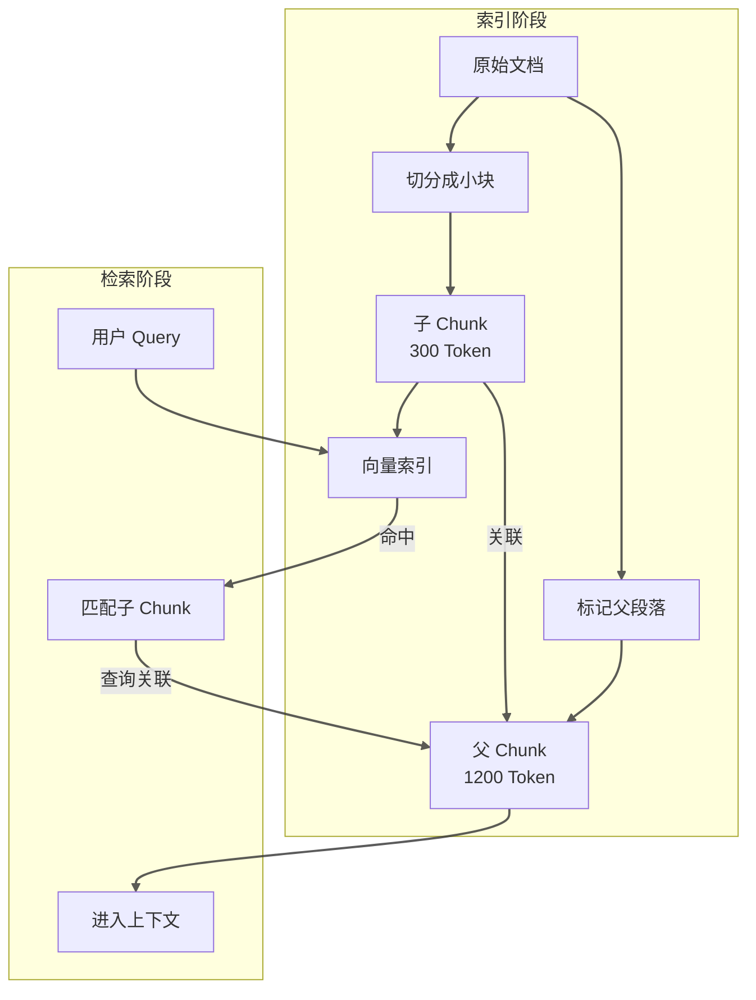
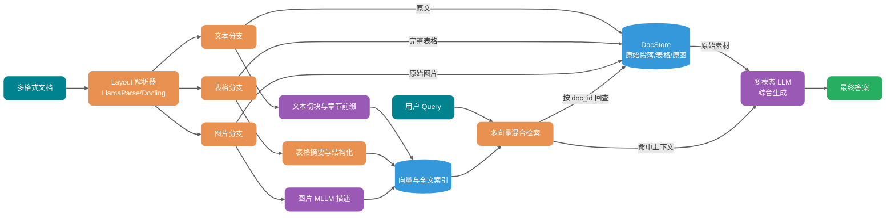

RAG 检索前要先把 PDF、Word、Excel 或扫描件转换成可检索内容。多栏 PDF 的阅读顺序、表格的行列关系、标题层级和 OCR 错误如果在这一步处理错了，后续更换 Embedding 模型或向量数据库也无法恢复丢失的信息。

本文按文档从上传、解析、切分、校验到多模态入库的顺序，说明各环节的工程做法与边界。

## 文档从上传到入库要经过哪些环节？

文档从上传到进入向量库，中间至少要经过六个环节：


质量校验不能留到入库之后才做。在解析和 Chunking 阶段加入分层抽样校验，可以提前拦截损坏文件、乱码和异常切分，避免低质量数据大批量写入向量库。

各环节的常见问题与下游影响如下：

| 环节        | 典型问题                           | 最终影响                   |
| ----------- | ---------------------------------- | -------------------------- |
| 文件上传    | 格式伪造、大小超限、编码混乱       | 解析器崩溃或静默失败       |
| 格式校验    | 扩展名和实际 MIME 类型不符         | 选错解析器                 |
| Layout 解析 | PDF 多栏、表格合并单元格、页眉页脚 | 结构丢失、上下文错位       |
| 清洗去噪    | 乱码、特殊字符、重复空行、目录残留 | 噪声入索引、Embedding 失真 |
| Chunking    | 语义截断、上下文断裂、块太大或太小 | 召回不准、答案残缺         |
| Metadata    | 没保存来源、页码、版本、权限       | 无法过滤、无法引用         |
| 入库        | 向量维度不一致、Token 超限         | 检索失败、索引损坏         |

Embedding 模型和向量库只能处理输入给它们的文本。多栏 PDF 的阅读顺序错乱、表格列关系丢失或 OCR 错字一旦进入索引，检索阶段无法从向量中还原原始结构。

## 如何选择合适的 Chunking 策略？


### 固定长度切分：建立评测基线

固定长度切分只需设定块大小（`chunk_size`）和相邻块重叠量（`chunk_overlap`），例如每 512 个 Token 切一块，相邻块重叠 50 到 100 个 Token。

这种方式实现简单、切分耗时极低，在短文档和单条 FAQ 场景下可以直接作为评测基线。它的局限在于不感知段落、表格和代码块边界。

举个例子，某段售后政策写着：

> 除以下情况外，均可申请七天无理由退货：（一）定制商品；（二）鲜活易腐商品；（三）在线下载的数字化商品……

如果这个列表刚好跨在固定长度的切分边界上，前一块只剩“除以下情况外，均可申请七天无理由退货”，后一块只有“（一）定制商品……”。无论召回哪一块，上下文都不完整，模型很容易漏掉限制条件。评估更复杂的切分方案前，可以先用固定长度切分跑通问题集，再看结构化切分能否显著改善这类边界断句。

### 递归字符切分：保留段落与句子边界

递归字符切分（Recursive Character Splitting）按一组分隔符优先级（如 `["\n\n", "\n", "。", " ", ""]`）逐层尝试。只有当一个自然段落超过目标块大小时，才会退一步按换行或句号继续拆分，从而在受控的 Token 范围内尽量保持章节、段落和句子的完整。

标题层级不规范、段落长短不一的文档（如技术博客、产品手册和研究报告）通常优先采用这种方案。LangChain 的 `RecursiveCharacterTextSplitter` 是典型实现，通用中文或英文技术文档可以从 400–800 Token 的块大小和 10%–15% 的重叠率开始测试；针对代码文件，则应使用 `RecursiveCharacterTextSplitter.from_language(Language.PYTHON, ...)` 等语言感知切分器，优先沿着 `class`、`def` 等语法边界切分，避免把单个函数体从中间截断。

### 语义切分：按主题边界聚合

语义切分（Semantic Chunking）不直接依赖固定字符数，而是先用句子分隔符拆出句子列表，计算相邻句子或滑窗的 Embedding 余弦距离，当语义距离突变超过阈值（如百分位阈值或标准差阈值）时才断开，把语义连贯的句子归入同一块。

这种策略的代价是离线构建阶段必须对大量句子计算 Embedding，索引耗时和成本明显高于字符切分。如果未配置最小与最大块长约束（`min_chunk_size` / `max_chunk_size`），主题频繁切换的位置会产生只有一两句话的极小块，单一主题长段落又可能超出上下文预算。上线前需要检查分块后的长度均值、P95 和过小块占比。

### 按文档结构切：复用版面与语法边界

当文档本身具备清晰的版面或语法结构时，直接沿结构边界切分通常比纯字符统计更稳。

在金融财报、法律合同等版式固定的文档中，单页往往对应一个相对独立的主题单元。NVIDIA 针对金融报告和法律文档的一组基准测试显示，按页面切分（Page-Level Chunking）的平均准确率为 0.648，方差也低于固定 Token 切分。但页面级切分并非在所有数据集上都占优：在 FinanceBench 数据集上，1024-Token 切分的准确率（0.579）就略高于页面级切分（0.566）。如果 PDF 只是普通 Word 文档随意导出的流式跨页排版，分页符本身不具备语义边界，按页切分并不会带来收益。此外，事实型查询通常偏好 256–512 Token 的细粒度块，而跨段落分析型查询更适合 1024+ Token 或页面级切分。

常见文档结构与起步切分方式如下：

| 文档类型 | 推荐切分方式                  | 常用工具 / 思路                                             |
| -------- | ----------------------------- | ----------------------------------------------------------- |
| Markdown | 按标题层级（H1/H2/H3）切      | `MarkdownHeaderTextSplitter` + 超长章节二次递归切分         |
| HTML     | 按语义标签切（h1~h6、p、div） | `HTMLHeaderTextSplitter` / `HTMLSectionSplitter`            |
| PDF      | 按章节标题、表格或页面切      | Docling、LlamaParse、`chunk_by_title`                       |
| 代码     | 按语法树（AST）、类、函数切   | Tree-sitter、`RecursiveCharacterTextSplitter.from_language` |
| 法规合同 | 按编、章、节、条、款切        | 正则结构识别 + 层级路径回填                                 |

### Parent-Child Chunk：分离召回粒度与阅读粒度

向量检索需要较小、主题聚焦的文本块来提高匹配精度，而生成模型需要包含前置条件和上下文的较长段落。Parent-Child Chunk（父子分块）将这两个目标拆开处理：用约 200–400 Token 的子块（Child Chunk）生成向量并建索引，同时通过 `parent_id` 关联到约 1000–1500 Token 的父块（Parent Chunk）或所属章节；在线检索命中子块后，按 `parent_id` 去重并拉取对应的父块送入 LLM 上下文。



这种模式在长篇技术手册、制度汇编和故障排查指南中很实用，代价是存储侧需要额外维护父块文档库（DocStore），且检索后多一次按主键批量回查。

### 重叠控制：缓解边界截断

无论采用固定长度还是递归切分，跨块边界都可能拆开同一件事。设置重叠窗口（Overlap）可以让边界附近的句子同时出现在前后两个 Chunk 中，但重叠比例过大会增加索引体积，还会让 Top-K 召回结果出现大量重复文本。

通用文本通常可以从 512 Token 块长、50–100 Token 重叠开始建立基线；代码、法规条文和独立表格则应优先保持语法或条款单元完整，仅在单元内部超长时使用重叠切分。文献中常能看到不同切分策略带来几十个百分点准确率差异的报告（例如[一项针对 30 个医疗问答样本的实验](https://pubmed.ncbi.nlm.nih.gov/41301150/)对比了自适应切分与固定切分），但这类结论高度依赖特定语料与问题设计，落地时必须基于自有评测集确定参数。

## 什么是语义丢失，为什么会发生？


语义丢失是指原始文档中的前置条件、指代对象或结构关系，在解析、清洗、切分过程中被削弱或剥离，导致单看切分后的 Chunk 无法还原原意。

### 语义丢失的四类常见场景

1. **条件与结论分离**：一段业务规则前半部分写申请条件，后半部分写审批流程，中间的例外条款“若满足 X，需补充 Y 材料”恰好落在切分边界上，导致前后两个块各自缺失关键约束。
2. **指代与背景丢失**：Chunk 只保留了孤立正文，丢掉了所属章节标题。模型读到“过去三年中该比例持续下降”时，无法判断“该比例”指的是某供应商的不良率还是某业务线的退货率。
3. **表格行列关系破坏**：多行多列表格被普通文本提取器拉平为一串失去对齐的纯文本，表头、行主键与数值单元格之间的对应关系彻底丢失。
4. **专有名词截断或断词**：英文 PDF 跨行连字符（如 `micro-\nservice`）、OCR 误识别（如把 `OAuth2` 识别成 `0Auth2`）或硬性按字符切分，把产品型号、接口名或内部代号拆碎，导致向量与关键词检索都无法命中。

### 为什么单块 Embedding 救不回丢失的上下文

标准 Embedding 模型编码时每次只接收单个 Chunk 的文本。如果跨段落的主语、适用范围和表格表头没有保留在当前块内，生成的向量就只反映局部字面含义。

工程上可以从四个方向补齐上下文，按改造成本从低到高排列：

1. **章节路径回填（Title / Breadcrumb Prepends）**：切分时把文档标题和各级父标题拼到每个 Chunk 开头（如 `[订单系统 > 退款规范 > 特殊商品] 正文...`），并同步写入 Metadata。这个做法几乎不增加额外算力，却能有效消除指代不明问题。
2. **多检索入口扩充（摘要与假设问题）**：为重要 Chunk 生成简短摘要或 2–3 个可能回答的用户问题（如“钱怎么退”对应正文“退款申请路径”），将问题向量与正文向量同时关联到原 Chunk，缩小用户口语提问与严谨公文之间的表述差距。
3. **上下文增强切分（Contextual Chunking）**：Anthropic 等团队提出的做法是在切分后调用小模型，结合整篇文档为每个 Chunk 生成 50–100 Token 的背景说明，拼接在 Chunk 前再做 Embedding 和 BM25 索引。效果提升明显，但离线构建需要额外的 LLM Token 成本，可通过 Prompt Caching 降低开销。
4. **延迟切分（Late Chunking）**：先将整篇长文档（在长上下文 Embedding 模型窗口允许范围内，如 8192 Token）送入 Transformer 编码层，让每个 Token 的隐状态融合全文注意力，最后再按 Chunk 边界对 Token 向量做均值池化（Mean Pooling）。这种方式无需调用生成模型就能保留全文指代信息，适合支持长输入的本地 Embedding 模型。

## 如何处理结构丢失问题？


不同文件格式在解析阶段丢失结构的原因各不相同，不能全部交给同一个纯文本提取器。

### PDF 多栏布局与复杂表格

PDF 本质上是版面绘制指令集合，底层文本对象的存储顺序未必等于人类的阅读顺序。双栏论文或财报如果只用基础的 PyPDF 按流顺序提取，经常把左栏上半句和右栏上半句拼在同一行；遇到跨行合并单元格或无线框财务表格时，行列错位会更严重。

这类文档需要引入版面感知解析器（Layout-Aware Parser），先通过视觉模型识别标题、正文栏、表格、公式和页眉页脚的边界框（Bounding Box），还原阅读顺序后再提取内容。开源方案可以评估 Docling（内置针对表格结构的 TableFormer）、MinerU、Marker，商用或云端服务可以评估 LlamaParse、Azure Document Intelligence 等。对于合同、财报等高价值文档，如果解析出的表格列数不一或数值校验不平，应将对应页面打标转入人工复核队列。

### Word 标题层级还原

Word（`.docx`）文档通常依赖段落样式（`Heading 1`、`Heading 2`、正文）组织结构，但实际业务文档往往排版不规范：有的作者直接把普通段落加粗放大当标题，有的整篇只用一级标题，或者在一级标题下紧接着写二级标题而中间没有正文。

解析 Word 时，不仅要读取段落样式或大纲级别，还要用栈结构维护当前的标题层级路径，防止父标题被紧随其后的子标题覆盖，或丢失第一个标题之前的导言内容：

```python
from docx import Document


def extract_sections(doc_path):
    """
    按 Word 标题层级提取章节内容，并保留完整的章节路径（section_path）
    """
    doc = Document(doc_path)
    heading_stack = []  # 元素为 (level, heading_text)
    current_content = []

    def current_path():
        return " / ".join(text for _, text in heading_stack) if heading_stack else "正文导言"

    for para in doc.paragraphs:
        text = para.text.strip()
        if not text:
            continue

        style_name = para.style.name if para.style else ""
        if style_name.startswith("Heading"):
            # 遇到新标题前，先输出上一段累积的正文
            if current_content:
                yield {
                    "section_path": current_path(),
                    "content": "\n".join(current_content),
                }
                current_content = []

            # 解析标题级别（如 "Heading 2" -> 2），弹出栈中同级或更深层级的旧标题
            parts = style_name.split()
            level = int(parts[1]) if len(parts) > 1 and parts[1].isdigit() else 1
            while heading_stack and heading_stack[-1][0] >= level:
                heading_stack.pop()
            heading_stack.append((level, text))
        else:
            current_content.append(text)

    if current_content:
        yield {
            "section_path": current_path(),
            "content": "\n".join(current_content),
        }
```

### Excel 字段关联

Excel 的单元格含义由行表头、列表头、合并单元格和 Sheet 名称共同决定。如果把单元格拆散成纯文本，字段名与数值的对应关系就会断开。

处理 Excel 或 CSV 时，应先识别有效数据区域与多级表头，再按文档用途转换：

- **明细与统计报表**：将每一行（或一组聚合记录）拼接为包含完整表头键值对的 JSON 或 Markdown 行记录，并附上 Sheet 名称、统计口径和单位。
- **配置与参数映射表**：将“参数名 - 默认值 - 说明”组装为自包含的条目文本。
- **大规模数值表**：如果用户高频问题涉及求和、同比计算或条件筛选，单纯靠向量检索文本块很难算准，建议将结构化表同步写入关系型数据库，通过 Text2SQL 或工具调用查询。

### 扫描件的 OCR 质量控制

扫描版 PDF 和图片文档依赖 OCR 转成文本，识别准确率受分辨率、印章遮挡、倾斜度和手写批注影响很大。常见错误集中在三处：字符混淆（如数字 `0` 与字母 `O`、数字 `1` 与字母 `l`），这会直接导致产品型号、合同编号检索失效；表格框线断裂导致跨列串行；双栏或批注与正文混排导致段落错乱。

处理扫描件时，可以在 OCR 前先做图像纠偏与去噪，选用支持版面分析的 OCR 引擎（如 PaddleOCR、Surya、Google Document AI 或 AWS Textract）。对型号、身份证号、金额等关键字段，入库前应配合正则表达式或“分项之和等于合计”等业务规则校验，校验失败的页面触发告警或人工核对。

## 如何设计分层校验策略？


生产环境中的上传文档质量参差不齐，文档处理管线必须在上传、解析和切分三个阶段设置校验关卡，并为失败文档准备明确的降级路径。

### 三道校验关卡

第一道是上传阶段的文件格式校验，在落盘或进入解析队列前检查扩展名、真实 MIME 类型（基于文件魔数 Magic Bytes，如 Apache Tika 检测，防止把 `.exe` 或损坏压缩包改名为 `.pdf`）、文件大小和加密状态。

```java
public class DocumentValidationException extends RuntimeException {
  private final ValidationErrorType errorType;
  private final String fileName;
  private final Object rejectedValue;

  public enum ValidationErrorType {
    FILE_TOO_LARGE,     // 文件大小超限
    UNSUPPORTED_FORMAT, // 不支持的格式
    MIME_TYPE_MISMATCH, // 扩展名与实际 MIME 类型不符
    CORRUPTED_FILE,     // 文件损坏或加密无法读取
    EMPTY_FILE,         // 空文件
    ENCODING_ERROR      // 字符编码异常
  }
}
```

第二道是解析结果校验。解析器返回文本后，检查提取出的字符数是否为空或异常偏短（例如 50 页的扫描版 PDF 用纯文本解析器只抽出几十个空白字符，说明需要转走 OCR 分支），并统计乱码字符（如 `` 及不可见控制字符）比例。

```java
public class ParseResultValidator {

  public ValidationResult validate(DocumentParseResult parseResult) {
    List<String> errors = new ArrayList<>();

    if (parseResult.getContent().isEmpty()) {
      errors.add("解析结果为空，可能是纯图片扫描件或加密文档");
    }

    double garbledRate = calculateGarbledRate(parseResult.getContent());
    if (garbledRate > 0.05) { // 超过 5% 乱码字符
      errors.add("乱码率过高: " + String.format("%.2f%%", garbledRate * 100));
    }

    int contentLength = parseResult.getContent().length();
    if (contentLength < 50) {
      errors.add("有效内容过短，可能解析不完整");
    }
    if (contentLength > 10_000_000) {
      errors.add("单文档文本超过上限，需按章节拆分处理");
    }

    if (parseResult.hasStructure()) {
      validateStructure(parseResult.getStructure()).forEach(errors::add);
    }

    return new ValidationResult(errors);
  }
}
```

第三道是切分质量校验。Chunking 完成后，检查生成的块数量、最小/最大长度、长度标准差，排查是否出现了大量只有几个字符的碎片块，或者超出 Embedding 模型输入上限的超大块。

```java
public class ChunkingQualityReport {
  private final int totalChunks;
  private final int totalCharacters;
  private final double averageChunkSize;
  private final int minChunkSize;
  private final int maxChunkSize;
  private final double chunkSizeStdDev;

  private final List<String> warnings = new ArrayList<>();
  private final List<String> errors = new ArrayList<>();

  public boolean isAcceptable() {
    if (chunkSizeStdDev > averageChunkSize * 0.5) {
      warnings.add("Chunk 大小分布波动较大，请检查结构分隔符是否匹配当前文档");
    }

    if (minChunkSize < 20) {
      warnings.add("存在过小的碎片 Chunk，建议合并到相邻块");
    }

    if (maxChunkSize > 5000) {
      errors.add("存在超长 Chunk，可能超出 Embedding 模型 Token 上限");
    }

    return errors.isEmpty();
  }
}
```

### 异常降级策略

校验未通过时，不能静默丢弃失败页面，而应按失败原因分流：

| 校验失败类型     | 处理策略                                                   |
| ---------------- | ---------------------------------------------------------- |
| 空文件或格式伪造 | 直接拒绝入库，记录审计日志并向调用方返回明确错误码         |
| 纯图片扫描件 PDF | 自动路由至 OCR + 版面分析管线重新提取                      |
| 复杂解析器失败   | 切换备用解析器重试，仍失败则转入人工复核队列               |
| 结构化切分异常   | 合并碎片块，或回退到带章节前缀的递归字符切分               |
| 部分页面解析失败 | 记录缺页页码并标记文档状态为“部分可用”；合同法规类暂缓发布 |

一份 100 页的文档如果有 10 页表格解析失败，绝不能把剩下 90 页直接标为“完整入库”。对于合同、法规、财务报告等要求证据完整的资料，存在缺页时应阻断上线并通知人工处理；对于允许部分入库的普通参考资料，也必须在文档元数据中记录缺失页码，防止系统对缺失范围给出确定性回答。

## 如何处理多模态内容？

真实企业文档中包含大量架构图、界面截图、流程图、跨页表格和统计图表。如果解析管线直接丢弃非文本元素，涉及图表和流程的提问就会因为缺少证据而答错。

### 图片内容的三条处理路径

首先要在解析阶段过滤掉页眉 Logo、背景底纹、纯装饰性图标等无信息量图片（可按尺寸阈值、纵横比或同一位置跨页重复出现频率剔除），只对承载业务信息的截图、架构图和流程图做入库处理。常用方案有三种：

1. **多模态 Embedding（如 CLIP / SigLIP / ColPali）+ 原图回传**：将图片直接编码进图文对齐向量空间（或像 ColPali 那样直接对文档页面图像生成多向量表示），查询时用文本向量匹配图片向量，命中后将原图从对象存储取出交给多模态大模型（MLLM）作答。需注意通用 CLIP 模型对自然图像效果较好，但对包含密集中文小字、复杂连线的系统架构图或报错截图区分度有限。
2. **MLLM 生成图像详述 + 文本检索**：离线入库时调用视觉大模型（结合图片上下文标题与正文中对该图的引用段落）生成详细的文本描述，将描述文本写入常规向量库和全文索引，同时在 Metadata 中保留原图对象存储 URI。
3. **多向量索引（Multi-Vector Retriever）**：将上述第二步工程化——向量索引中存放便于检索的图片结构化摘要（包含图中文字、节点流向、核心结论），DocStore（如对象存储 + 键值库）存放原始高清图。检索命中摘要后，根据 `doc_id` 取回原图连同文本上下文一并送入多模态 LLM。

```python
# LangChain 多向量检索示例
# 注：LangChain 0.3 可从 langchain.retrievers.multi_vector 导入；LangChain 1.0+ 迁移至 langchain_classic
from langchain_classic.retrievers.multi_vector import MultiVectorRetriever
from langchain_core.stores import InMemoryByteStore

# 向量库存储图像/表格的文本摘要，用于检索匹配
vectorstore = Chroma(
    collection_name="multimodal_summaries",
    embedding_function=OpenAIEmbeddings(),
)

# DocStore 存储原始图片字节或完整表格内容（生产环境应替换为 S3 + Redis/PostgreSQL）
docstore = InMemoryByteStore()

retriever = MultiVectorRetriever(
    vectorstore=vectorstore,
    byte_store=docstore,
    id_key="doc_id",
    search_kwargs={"k": 5},
)
```

### 表格内容的结构化保留

表格一旦被当成普通连续文本切分，不仅表头和数值脱节，切分在中间的行还会彻底失去表头信息。工程上通常结合以下做法：

1. **保留结构化格式**：利用 Docling、LlamaParse 等工具将表格还原为 Markdown 表格、HTML `<table>`（含 `rowspan` / `colspan` 合并单元格信息）或 JSON 行数组。若单个大表超过 Chunk 长度上限，按行拆分时必须在每个子块顶部重复拼接完整表头。
2. **生成表格语义摘要**：纯数字密集的财务或监控表格在向量空间中很难与自然语言提问对齐。可以为每个表格生成一段包含所属章节、表格标题、时间范围、统计维度与核心指标的文字摘要（例如：“华东区 2024 年度各产品线销量汇总表，包含手机 A、手机 B 在 Q1/Q2 的销量与环比增长率，单位：台”），对摘要建向量索引，命中后把完整 Markdown/JSON 表格带入生成上下文。

### 图表内容（Charts）的上下文绑定

折线图、柱状图和饼图的含义高度依赖图题（Caption）、坐标轴名称、图例、度量单位以及正文中引用该图的分析段落。离线调用 MLLM 提取图表信息时，应把图表所在页的图题和前后相邻段落一并传入，要求模型输出结构化描述（包含统计对象、时间区间、单位、极值点与趋势结论）及对应的数据表，避免单看裸图把“百万元”误读为“元”或弄混系列图例。

### 完整的多模态 RAG 链路

将文本、表格和图片的解析、摘要索引与原始素材回传串联起来，完整的多模态处理架构如下：



这套链路的核心设计是检索表示与生成素材分离：向量与全文索引中存储易于语义匹配的文本块、表格说明和图片描述；DocStore 中保留未压缩的完整表格、父段落与高清原图，检索命中后再按 `doc_id` 组装给生成模型。

## 如何从零搭建文档处理管线？


搭建企业文档处理管线时，建议按格式复杂度分阶段推进，不要一开始就在所有文件上叠加高成本的视觉模型：

1. **阶段一（结构化纯文本基线）**：先打通 Markdown、HTML、规范 Word 文档的解析，实现基于标题层级的递归切分，把 `doc_id`、`section_path`、更新时间、权限 ACL 写入 Metadata，跑通基础评测集。
2. **阶段二（复杂版面 PDF 与表格治理）**：针对多栏 PDF、合并单元格表格和扫描件，接入 Docling、MinerU 或 LlamaParse 等版面感知解析器与 OCR 管线，补齐三层质量校验、超长表头重复拼接与异常文档降级队列。
3. **阶段三（父子分块与多模态扩展）**：当坏例分析发现细粒度召回与长上下文完整性冲突时，引入 Parent-Child 分块或章节上下文增强；当业务高度依赖流程图、架构图或财报图表时，再按需接入 MLLM 图表描述与 Multi-Vector 检索。

## 总结

文档处理与切分决定了索引里到底有没有完整、准确的证据。上线和后续迭代解析器或切分参数时，至少需要核对四项检查：

1. **版面与结构保真**：抽查多栏 PDF 的阅读顺序、跨页表格的行列对应关系、Word/Markdown 的章节路径（`section_path`）以及扫描件关键字段的 OCR 准确率。
2. **块粒度与上下文完整**：确认 Chunk 没有把前置条件与结论硬性截断，长表拆分保留了表头，统计并监控块长分布与碎片块比例。
3. **Metadata 齐全可查**：每个 Chunk 都绑定了来源文档 ID、版本号、页码、章节路径和权限 ACL，支持前置过滤与答案溯源。
4. **固定评测集回归**：每次更换解析工具或调整 `chunk_size` / `chunk_overlap` 后，都在同一批覆盖表格、跨段条件和专有名词的问题集上对比 Context Recall 与最终答案准确率。

## 参考资料

- [Databricks: Mastering Chunking Strategies for RAG](https://community.databricks.com/t5/technical-blog/the-ultimate-guide-to-chunking-strategies-for-rag-applications/ba-p/113089)
- [Firecrawl: Best Chunking Strategies for RAG in 2026](https://www.firecrawl.dev/blog/best-chunking-strategies-rag)
- [Premiere AI: RAG Chunking Strategies 2026 Benchmark Guide](https://blog.premai.io/rag-chunking-strategies-the-2026-benchmark-guide/)
- [Weaviate: Chunking Strategies to Improve LLM RAG Pipeline Performance](https://weaviate.io/blog/chunking-strategies-for-rag)
- [Omdena: Document Parsing for RAG - A Complete Guide for 2026](https://www.omdena.com/blog/document-parsing-for-rag)
- [DataCamp: Multimodal RAG - A Hands-On Guide](https://www.datacamp.com/tutorial/multimodal-rag)
- [LangChain: Multi-Vector Retriever for RAG on Tables, Text, and Images](https://www.langchain.com/blog/semi-structured-multi-modal-rag)
- [Procycons: PDF Data Extraction Benchmark 2025](https://procycons.com/en/blogs/pdf-data-extraction-benchmark/)
- [LlamaIndex: Mastering PDF Parsing](https://www.llamaindex.ai/blog/mastering-pdfs-extracting-sections-headings-paragraphs-and-tables-with-cutting-edge-parser-faea18870125)
